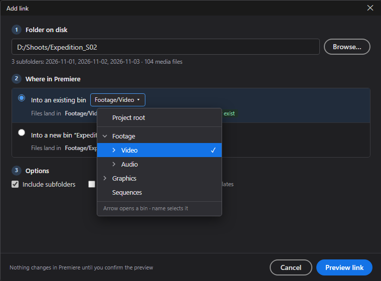
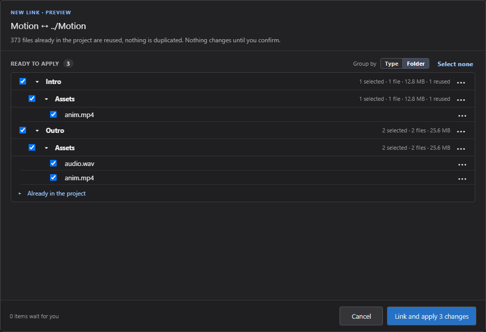
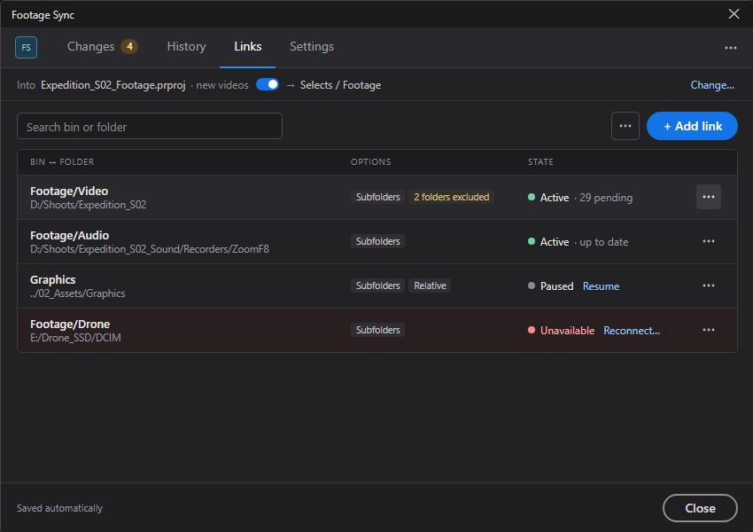
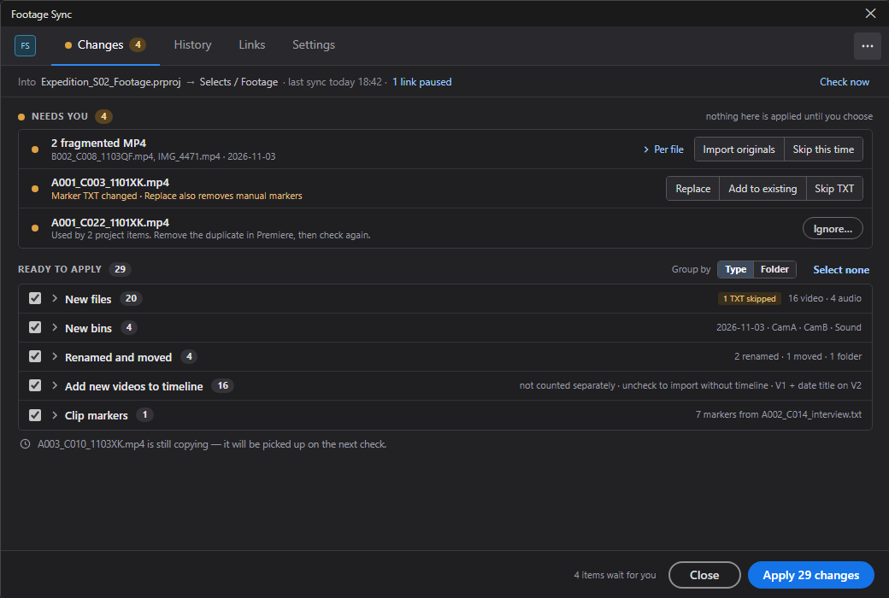

# Footage Sync

Footage Sync — плагин для Adobe Premiere Pro, который связывает папки на диске с бинами проекта и сам подтягивает новый футаж. Бины повторяют структуру папок, уже импортированные файлы не дублируются, а переименованные и перенесённые остаются теми же клипами. Новые видео плагин может сразу класть в конец выбранной секвенции с титром-датой. Он ничего не удаляет ни на диске, ни в проекте.

**Windows 11 · Premiere Pro 25.6 и новее · [Установка](#установка)**

## Установка

Готового пакета с текущим интерфейсом пока нет. Опубликованный [релиз v0.1.0](https://github.com/VslyDream/footage-sync/releases/tag/v0.1.0) старше: в нём прежние окна и нет импорта на таймлайн. Текущая версия ставится копированием папки.

1. Сохраните проекты и полностью закройте Premiere.
2. На странице репозитория нажмите **Code → Download ZIP** и распакуйте архив.
3. Откройте в Проводнике `%APPDATA%\Adobe\UXP\Plugins\External`. Если папки `External` нет, создайте её.
4. Скопируйте туда папку `plugin` из архива и переименуйте её в `com.vsly.footage-sync_0.1.0`. Файл `manifest.json` должен лежать прямо в ней.
5. Запустите Premiere и откройте **Window → UXP Plugins → Footage Sync → Footage Sync**. Панель удобно закрепить узкой колонкой рядом с окном проекта.

Для обновления повторите шаги 1–4 и замените папку целиком. Node, FFmpeg и другие программы плагину не нужны. Если Premiere не показывает плагин, проверьте версию Premiere и вложенность папок.

Сборки для macOS лежат в релизе v0.1.0, но на настоящем Mac плагин ещё не запускался. Шаги описаны в [инструкции для Mac](docs/INSTALL_MAC_MANUAL_V0_1_RU.md).

## Первый запуск

1. Откройте в Premiere сохранённый проект, в котором хранится футаж, — обычно `…_Footage.prproj`. Если новые видео нужно сразу раскладывать на таймлайн, откройте и проект с секвенцией, например `…_Selects.prproj`.
2. Нажмите **Links** на панели. В верхней строке вкладки нажмите **Choose…** → **Change import project…** и выберите проект. Плагин запомнит его и не переключится на другой, когда вы смените проект в Premiere.
3. Нажмите **+ Add link**. Укажите папку на диске и бин: существующий (**Into an existing bin**) или новый с именем папки (**Into a new bin**). Бины показаны раскрывающимся деревом, первым пунктом идёт **Project root**.
4. Нажмите **Preview link**. В превью видно, какие папки станут бинами, какие файлы импортируются и сколько уже импортированных будет использовано повторно. Снимите галочки с лишнего и нажмите **Link and apply N changes**. До этой кнопки проект не меняется.



<details>
<summary><strong>Превью новой связи — дерево папок и исключения</strong></summary>

Папки показаны так же, как лежат на диске. Стрелка раскрывает папку, галочка включает её в синхронизацию. Уже импортированные файлы свёрнуты в блок **Already in the project** и повторно не импортируются.



В меню ⋯ папки:

| Пункт | Что делает |
| --- | --- |
| **Exclude this folder** | Папка не синхронизируется. В Premiere при этом ничего не меняется. |
| **Show all N files** | Показывает все файлы папки. |
| **Ignore a file…** | Скрывает из синхронизации один файл. |

</details>

<details>
<summary><strong>Импорт на таймлайн — секвенция, титр с датой и Fill Frame</strong></summary>

В верхней строке вкладки **Links** нажмите **Change…** → **Change timeline…** и выберите секвенцию, обычно `…_Selects.prproj → Footage`. Переключатель **new videos** в той же строке включает и выключает раскладку. Выбранная секвенция при выключении запоминается.

| Что | Как |
| --- | --- |
| Куда ложится видео | Целиком в конец секвенции: картинка на V1, звук начиная с A1. Внутри одной пачки порядок по дате, затем по имени файла. |
| Титр | На V2 создаётся обычный редактируемый текст с датой из имени папки вида `ГГГГ-ММ-ДД`, своей или родительской. Для `2026-10-27-Developer` это `2026-10-27`. Если даты в пути нет или их несколько разных, текстом становится имя папки. |
| Несколько клипов одной даты | Получают один общий титр. Клипы той же даты, добавленные позже в конец того же блока, продлевают его. |
| Масштаб | К новым клипам применяется Fill Frame: кадр заполняется целиком с сохранением пропорций. |
| Что не меняется | Существующий монтаж, ранее импортированные клипы и видео, добавленные при выключенном переключателе. |



Пока идёт раскладка, на кнопке **Sync** видна полоска прогресса, а в Premiere можно продолжать работать.

</details>

## Синхронизация

На панели три кнопки без подписей. Названия видны при наведении.

| Кнопка | Что делает |
| --- | --- |
| **Links** | Открывает список связей «бин ↔ папка». |
| **Sync** | Проверяет папки и применяет изменения. Оранжевая точка на кнопке значит, что сначала откроется вкладка **Changes**: там ждёт ваше решение. |
| **Status** | Открывает вкладку **Changes**. Синее число показывает, сколько изменений ждёт, оранжевое — сколько из них требуют решения. |


Плагин сам проверяет связанные папки каждые 5 секунд и копит найденное.

| На диске | В Premiere |
| --- | --- |
| Появился файл | Импортируется в бин, соответствующий папке. |
| Появилась папка | Создаётся бин с тем же именем. |
| Файл переименован или перенесён | Существующий клип привязывается к новому пути и переезжает в нужный бин. Второй клип не создаётся. |
| Папка переименована | Бин переименовывается, клипы внутри привязываются к новым путям. |
| Файл или папка удалены | Ничего: клипы и бины остаются. |

Если вы вручную перенесли клип в другой бин, следующий Sync вернёт его в бин, соответствующий папке на диске.

### Вкладка Changes

Всё, что ждёт, показано двумя блоками.



**Needs you** — то, что без вашего выбора не применится.

| Что ждёт | Кнопки | Что они делают |
| --- | --- | --- |
| Фрагментированный MP4 | **Import original** / **Skip this time** | Импортировать файл как есть или отложить его до следующего Sync. |
| Изменился TXT с маркерами | **Replace** / **Add to existing** / **Skip TXT** | Заменить маркеры клипа (удалит и поставленные вручную), добавить новые к имеющимся или оставить как есть. |
| Файл не читается или занят двумя клипами проекта | **Ignore…** | Скрыть файл или папку из синхронизации. |
| Добавление на таймлайн прервалось или отменено | **Append again** / **Keep current sequence** | Повторить раскладку без дублей или оставить секвенцию как есть. |
| Недоступен проект или секвенция для импорта | **Choose target…** / **Choose timeline…** | Выбрать цель заново. |

Фрагментированный MP4 — запись, сохранённая кусками. Premiere не всегда читает такие файлы правильно, поэтому плагин не импортирует их молча.

**Ready to apply** — то, что применится по кнопке **Apply N changes**: новые файлы и бины, переименования и переносы, добавление на таймлайн, маркеры. Снятая галочка оставляет изменение ждать. Переключатель **Group by** группирует список по типу изменения или по папкам. **Close** закрывает окно, ничего не применяя.

Кнопка **Sync** на панели применяет всё сразу, если в блоке **Needs you** пусто. Если там что-то есть, она открывает **Changes**, и до **Apply** ничего не меняется.

Во время синхронизации окно можно закрыть: работа продолжится. Нажмите на крутящийся значок **Sync**, чтобы увидеть текущий этап, файл и счётчики. Завершённые запуски и причины сбоев собраны во вкладке **History**.

## Если файл или папка мешают

| Задача | Где |
| --- | --- |
| Скрыть файл или папку с проблемой | В **Changes** меню ⋯ строки → **Ignore this file…** или **Ignore folder…** |
| Не синхронизировать тяжёлые подпапки связи, например прокси и рендеры | В **Links** меню ⋯ связи → **Exclude subfolders…** |
| Импортировать файл, но не класть его на таймлайн | В **Changes** меню ⋯ строки → **Import without adding to timeline** |
| Временно остановить связь | В **Links** меню ⋯ связи → **Pause** |
| Вернуть скрытое | В **Links** меню ⋯ над таблицей → **Ignored files and folders** → **Restore** |

Скрытые пути не сканируются и не дают предупреждений, включая новые файлы внутри скрытой папки. Уже созданные клипы, бины и монтаж при этом не меняются.

Если папка связи недоступна, например отключён диск или папку переименовали, связь получает состояние **Unavailable**. Из Premiere при этом ничего не удаляется. Пока такая связь активна, кнопка **Sync** на панели не работает, а режим **Automatically** ждёт. Нажмите **Reconnect…** и укажите папку заново либо поставьте связь на паузу. Изменения остальных связей можно применить во вкладке **Changes**.

Если Premiere потерял выбранный проект для импорта, плагин сам найдёт его по сохранённому пути, как только проект снова будет открыт. Другой открытый проект он не подставит.

## Маркеры из TXT

Плагин ставит цветные маркеры на исходный клип по текстовому файлу. Положите TXT рядом с MP4 так, чтобы имя TXT целиком входило в имя видео: `interview.txt` подойдёт к `interview_take2.mp4`. Маркеры появятся при следующем Sync. Секвенция для этого не нужна.

<details>
<summary><strong>Формат TXT, цвета и правила</strong></summary>

Одна строка — один маркер: `Ч:ММ:СС,цвет`. Время считается в целых секундах от начала видео.

```text
0:00:53,1
0:01:12,4
```

| Номер | 0 | 1 | 2 | 3 | 4 | 5 | 6 | 7 |
| --- | --- | --- | --- | --- | --- | --- | --- | --- |
| Цвет | зелёный | красный | фиолетовый | оранжевый | жёлтый | белый | синий | бирюзовый |

- Ошибка в любой строке или время за пределами длительности видео: весь TXT пропускается с предупреждением и номером строки. Само видео импортируется.
- Повторный Sync маркеры не дублирует и ваши правки не трогает. Изменённый TXT ждёт решения в **Needs you**.
- Если к видео подходит несколько TXT, автоматически не применяется ни один.
- Чтобы назначить TXT вручную, откройте меню ⋯ окна → **Add markers from TXT…**, выберите файл, затем клип. Ручной выбор важнее автопоиска.
- Автопоиск отключается во вкладке **Settings**, пункт **Clip markers**.

Ограничения:

- Undo в Premiere не отменяет поставленные маркеры.
- Если в Premiere включено **Preferences → Media → Write clip markers to XMP**, Premiere записывает маркеры в сам файл видео. Плагин эту настройку не меняет.
- Polden OBS пишет номера цветов 1–8, а Footage Sync читает 0–7. Пока форматы не сведены, цвета из его TXT сдвигаются на один, а файл с цветом 8 пропускается целиком.

</details>

## Настройки

Вкладка **Settings** сохраняет изменения сразу.

| Настройка | Варианты | По умолчанию |
| --- | --- | --- |
| **Apply changes** | **When I press Sync** — изменения копятся и ждут кнопки. **Automatically** — применяются сами, если ничего не требует решения. | When I press Sync |
| **Fragmented MP4** | **Ask in Review** — спросить в Changes. **Import original as is** — импортировать без вопроса. **Repair before import** пока недоступен. | Ask in Review |
| **Clip markers** | **Find a marker TXT next to each video** | Включено |

В режиме **Automatically** плагин работает и при закрытой панели, пока открыт Premiere.

Связи и настройки хранятся рядом с проектом для импорта в файле `<проект>.prproj.footage-sync.json`. Переносите его вместе с проектом. Плагин не сохраняет проект за вас: после синхронизации сохраните его обычной командой Premiere.

## Как плагин принимает решения

- **Диск главный.** Бины повторяют папки, а не наоборот: переименование бина в Premiere папку не переименует.
- **Ничего не удаляется.** Удаление файла или папки на диске не убирает клипы и бины из проекта.
- **Без дубликатов.** Уже импортированный файл используется повторно, даже если лежит в другом бине.
- **Спорное ждёт вас.** Плагин не выбирает за вас и не показывает окно на каждый файл: всё, что требует решения, собрано в одном блоке.
- **Одна проблема не останавливает остальное.** Ошибка в TXT не мешает импорту видео, а проблема с секвенцией — импорту файлов.
- **Исходники и проект остаются вашими.** Плагин не переписывает файлы на диске и не сохраняет проект автоматически.
- **Монтаж важнее.** Панель занимает одну узкую колонку, а проверка папок не перечитывает сами видео: только списки файлов и заголовки MP4.

## Чего пока нет

- **Починки фрагментированных MP4.** Такой файл можно импортировать как есть или пропустить.
- **Проверки на macOS.** Сборки есть, на настоящем Mac плагин не запускался.
- **Замеров на больших и сетевых папках.** Скорость на LucidLink и других сетевых дисках не измерялась.

Остальное, включая общие настройки для участников Production и уведомления в автоматическом режиме, перечислено в [STATE.md](STATE.md).

<details>
<summary><strong>Для разработки</strong></summary>

Исходники плагина лежат в `plugin/`. Сборки нет: Premiere загружает эти файлы как есть. Для проверок нужен Node 24 или новее, для упаковки релиза и скрипта установки — PowerShell 7.

```text
npm test          # автоматические тесты
npm run check     # синтаксис файлов и манифест
npm run package   # CCX и ZIP для релиза
```

Скрипт установки копирует `plugin/` в папку плагинов и отказывается работать при запущенном Premiere:

```powershell
./scripts/install-dev.ps1 -PremierePath "C:\Program Files\Adobe\Adobe Premiere Pro 2025\Adobe Premiere Pro.exe"
```

Правила работы агентов описаны в [AGENTS.md](AGENTS.md).

</details>

---

[Что проверено и что открыто](STATE.md) · [Продуктовый контракт](SPEC.md) · [Экраны](docs/UI_SPEC.md) · [Планы](docs/FUTURE_VISION.md) · [Сообщить об ошибке](https://github.com/VslyDream/footage-sync/issues)
