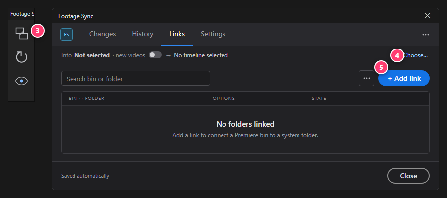
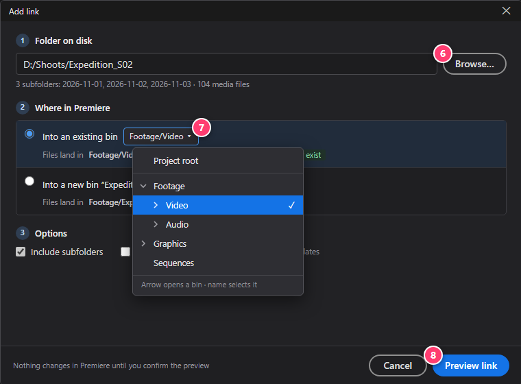
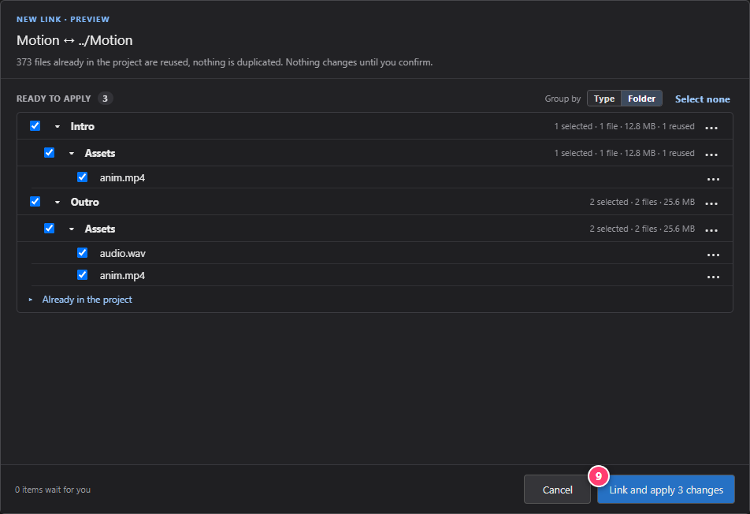
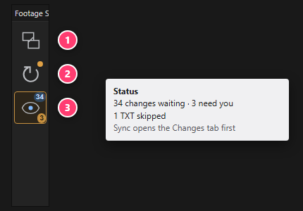
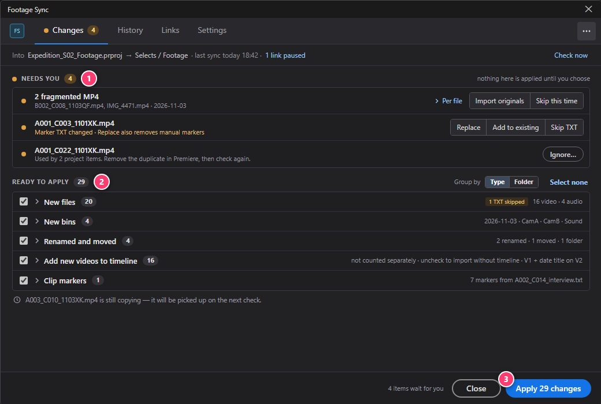

# Footage Sync

Footage Sync — плагин для Adobe Premiere Pro, который связывает папки на диске с бинами проекта и сам подтягивает новый футаж. Бины повторяют структуру папок, уже импортированные файлы не дублируются, а переименованные и перенесённые остаются теми же клипами. Новые видео плагин может сразу класть в конец выбранной секвенции с титром-датой. Он ничего не удаляет ни на диске, ни в проекте.

**Windows 11 · Premiere Pro 25.6 и новее**

## Установка

Поручите установку своему агенту (Claude Code, Codex): он сам скачает последнюю версию и положит плагин в папку Premiere. Скажите ему:

```text
Установи плагин Footage Sync для Premiere Pro по инструкции https://raw.githubusercontent.com/VslyDream/footage-sync/main/docs/INSTALL_AGENT.md
```

Чтобы поставить вручную, скачайте архив для Windows со [страницы релизов](https://github.com/VslyDream/footage-sync/releases) и пройдите шаги из [той же инструкции](docs/INSTALL_AGENT.md).

## Первый запуск

1. Откройте панель плагина в Premiere: **Window → UXP Plugins → Footage Sync → Footage Sync**.
2. В своём Production откройте проект Footage и, в большинстве случаев, проект Selects.
3. Нажмите **Links** на панели.
4. Нажмите **Choose…** → **Change import project…** и выберите проект Footage. Той же кнопкой → **Change timeline…** выберите секвенцию в Selects: туда будут ложиться новые видео.
5. Нажмите **+ Add link**.



6. Укажите папку с футажом на диске.
7. Выберите бин, в который попадёт её содержимое.
8. Нажмите **Preview link**.



9. Проверьте, что будет импортировано, и нажмите **Link and apply**. До этой кнопки проект не меняется.



<details>
<summary><strong>Что происходит с новым видео на таймлайне</strong></summary>

| Что | Как |
| --- | --- |
| Куда ложится видео | Целиком в конец выбранной секвенции: картинка на V1, звук начиная с A1. |
| Титр | На V2 появляется редактируемый текст с датой из имени папки вида `ГГГГ-ММ-ДД`. Для `2026-10-27-Developer` это `2026-10-27`. Если даты нет, текстом становится имя папки. Клипы одной даты получают общий титр. |
| Масштаб | К новым клипам применяется Fill Frame. |
| Что не меняется | Существующий монтаж и клипы, импортированные раньше. |

Раскладку включает и выключает переключатель **new videos** во вкладке **Links**. Пока она идёт, на кнопке **Sync** видна полоска прогресса, а в Premiere можно продолжать работать.

</details>

## Синхронизация



| | Кнопка | Что делает |
| --- | --- | --- |
| 1 | **Links** | Открывает список связей «бин ↔ папка». |
| 2 | **Sync** | Проверяет папки и применяет изменения. Оранжевая точка значит, что сначала откроется вкладка **Changes**: там ждёт ваше решение. |
| 3 | **Status** | Открывает вкладку **Changes**. Синее число показывает, сколько изменений ждёт, оранжевое — сколько из них требуют решения. |

Плагин сам проверяет связанные папки каждые 5 секунд.

| На диске | В Premiere |
| --- | --- |
| Появился файл | Импортируется в бин, соответствующий папке. |
| Появилась папка | Создаётся бин с тем же именем. |
| Файл переименован или перенесён | Тот же клип привязывается к новому пути и переезжает в нужный бин. |
| Папка переименована | Бин переименовывается. |
| Файл или папка удалены | Ничего: клипы и бины остаются. |

Клип, который вы вручную перенесли в другой бин, следующий Sync вернёт в бин, соответствующий папке на диске.

### Вкладка Changes



1. **Needs you** — то, что не применится без вашего выбора.
2. **Ready to apply** — то, что применится. Снятая галочка оставляет изменение ждать.
3. **Apply** применяет отмеченное. **Close** закрывает окно, ничего не меняя.

Окно можно закрыть во время синхронизации: работа продолжится. Нажатие на значок **Sync** во время работы показывает текущий этап и файл. Завершённые запуски и причины сбоев собраны во вкладке **History**.

<details>
<summary><strong>Какие решения бывают в Needs you</strong></summary>

| Что ждёт | Кнопки | Что они делают |
| --- | --- | --- |
| Фрагментированный MP4 | **Import original** / **Skip this time** | Импортировать файл как есть или отложить до следующего Sync. |
| Изменился TXT с маркерами | **Replace** / **Add to existing** / **Skip TXT** | Заменить маркеры клипа, включая поставленные вручную, добавить новые к имеющимся или оставить как есть. |
| Файл не читается или занят двумя клипами проекта | **Ignore…** | Скрыть файл или папку из синхронизации. |
| Добавление на таймлайн прервалось | **Append again** / **Keep current sequence** | Повторить раскладку без дублей или оставить секвенцию как есть. |
| Недоступен проект или секвенция для импорта | **Choose target…** / **Choose timeline…** | Выбрать цель заново. |

Фрагментированный MP4 — запись, сохранённая кусками. Premiere не всегда читает такие файлы правильно, поэтому плагин не импортирует их молча.

</details>

## Если файл или папка мешают

| Задача | Где |
| --- | --- |
| Скрыть файл или папку с проблемой | В **Changes** меню ⋯ строки → **Ignore this file…** или **Ignore folder…** |
| Не синхронизировать тяжёлые подпапки, например прокси и рендеры | В **Links** меню ⋯ связи → **Exclude subfolders…** |
| Импортировать файл, но не класть его на таймлайн | В **Changes** меню ⋯ строки → **Import without adding to timeline** |
| Временно остановить связь | В **Links** меню ⋯ связи → **Pause** |
| Вернуть скрытое | В **Links** меню ⋯ над таблицей → **Ignored files and folders** → **Restore** |

<details>
<summary><strong>Подробнее: скрытые пути, недоступная папка, потерянный проект</strong></summary>

**Скрытые пути** не сканируются и не дают предупреждений, включая новые файлы внутри скрытой папки. Уже созданные клипы, бины и монтаж при этом не меняются.

**Недоступная папка.** Если диск отключён или папку переименовали, связь получает состояние **Unavailable**. Из Premiere ничего не удаляется. Пока такая связь активна, кнопка **Sync** на панели не работает, а автоматический режим ждёт. Нажмите **Reconnect…** и укажите папку заново либо поставьте связь на паузу. Изменения остальных связей можно применить во вкладке **Changes**.

**Потерянный проект.** Если Premiere потерял выбранный проект для импорта, плагин сам найдёт его по сохранённому пути, как только проект снова будет открыт. Другой открытый проект он не подставит.

</details>

## Маркеры из TXT

Плагин ставит цветные маркеры на исходный клип по TXT, который лежит рядом с видео. Такие файлы пишет [Polden OBS](https://github.com/VslyDream/Polden-OBS): отметьте момент горячей клавишей во время записи, и после Sync маркер появится на клипе в Premiere. Как настроить клавиши, описано в [инструкции Polden OBS](https://github.com/VslyDream/Polden-OBS/blob/HEAD/docs/polden/markers.md).

<details>
<summary><strong>Формат TXT, цвета и правила</strong></summary>

Одна строка — один маркер: `Ч:ММ:СС,номер цвета`. Время считается в целых секундах от начала видео.

```text
0:00:53,1
0:01:12,4
```

| Номер | 1 | 2 | 3 | 4 | 5 | 6 | 7 | 8 |
| --- | --- | --- | --- | --- | --- | --- | --- | --- |
| Цвет | зелёный | красный | фиолетовый | оранжевый | жёлтый | белый | синий | бирюзовый |

- TXT подходит к MP4 из той же папки, если имя TXT целиком входит в имя видео: `interview.txt` подойдёт к `interview_take2.mp4`.
- Ошибка в любой строке или время за пределами длительности видео: весь TXT пропускается с предупреждением и номером строки. Само видео импортируется.
- Повторный Sync маркеры не дублирует и ваши правки не трогает.
- Чтобы назначить TXT вручную, откройте меню ⋯ окна → **Add markers from TXT…**.
- Undo в Premiere не отменяет поставленные маркеры.
- Если в Premiere включено **Preferences → Media → Write clip markers to XMP**, Premiere записывает маркеры в сам файл видео.

</details>

## Настройки

Вкладка **Settings** сохраняет изменения сразу.

| Настройка | Варианты | По умолчанию |
| --- | --- | --- |
| **Apply changes** | **When I press Sync** — изменения копятся и ждут кнопки. **Automatically** — применяются сами, если ничего не требует решения. | When I press Sync |
| **Fragmented MP4** | **Ask in Review** — спросить в Changes. **Import original as is** — импортировать без вопроса. | Ask in Review |
| **Clip markers** | **Find a marker TXT next to each video** — искать TXT рядом с видео. | Включено |

Связи и настройки лежат рядом с проектом в файле `<проект>.prproj.footage-sync.json`. Проект плагин не сохраняет: после синхронизации сохраните его сами.

## Как плагин принимает решения

- **Диск главный.** Бины повторяют папки, а не наоборот: переименование бина в Premiere папку не переименует.
- **Ничего не удаляется.** Удаление файла или папки на диске не убирает клипы и бины из проекта.
- **Без дубликатов.** Уже импортированный файл используется повторно, даже если лежит в другом бине.
- **Спорное ждёт вас.** Плагин не выбирает за вас и не показывает окно на каждый файл: всё, что требует решения, собрано в одном блоке.
- **Одна проблема не останавливает остальное.** Ошибка в TXT не мешает импорту видео, а проблема с секвенцией — импорту файлов.
- **Монтаж важнее.** Панель занимает одну узкую колонку, а проверка папок не перечитывает сами видео.

## Чего пока нет

- **Починки фрагментированных MP4.** Такой файл можно импортировать как есть или пропустить.
- **Проверки на macOS.** Сборки есть, на настоящем Mac плагин не запускался.
- **Замеров на больших и сетевых папках.** Скорость на LucidLink и других сетевых дисках не измерялась.

Полный список — в [STATE.md](STATE.md).

---

[Что проверено и что открыто](STATE.md) · [Продуктовый контракт](SPEC.md) · [Экраны](docs/UI_SPEC.md) · [Планы](docs/FUTURE_VISION.md) · [Для разработчиков и агентов](AGENTS.md) · [Сообщить об ошибке](https://github.com/VslyDream/footage-sync/issues)
