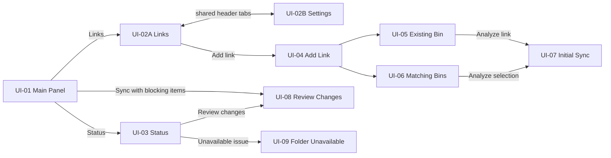

# Footage Sync — UI Contract

> Canonical description of the approved screen structure.  
> Product behavior remains canonical in [`SPEC.md`](../SPEC.md).  
> The interactive implementation in [`prototype/`](../prototype/) is a secondary review reference, not the source of requirements.

---

## 1. How to use this document

For a screen-level task, load:

1. the relevant product section in `SPEC.md`;
2. the single screen section below;
3. only the referenced image from `docs/ui/`, when that image exists.

Do not load the prototype source merely to understand layout. Inspect it only when implementing the UI or resolving an ambiguity.

Precedence when materials disagree:

1. `SPEC.md` — product behavior;
2. this document — screen structure, controls, states and transitions;
3. golden PNG — visual composition and density;
4. interactive prototype — demonstration only.

All user-facing strings are English. Documentation prose may be Russian/English.

Visual handoff finalized on 2026-10-02 using four screenshots supplied by the user: Main Panel, Links, Settings and Status. These are stored unchanged in `docs/ui/`. Other screen contracts and state variants are text-defined; additional browser capture is not a prerequisite for this handoff.

Screenshots establish layout and visual hierarchy. Example paths, counts and timestamps are mock data. Two visible prototype inconsistencies must not be carried into production:

- Settings says Manual sync is available only from Status; `SPEC.md` also permits Main Panel `Sync`.
- Status shows `Up to date` alongside `17` pending changes, `2` conflicts and attention cards. Render real counts and a consistent status derived from current data; the pictured combination is demonstration content.

Image dimensions are export dimensions, not new requirements for window size. FUT-002 decision on 2026-10-06 supersedes the original Main Panel composition and `320–360 px` target. Its original PNG is preserved as a previous-design reference; the approved adaptive target is text-defined below, with supplemental implementation captures and partial real Premiere acceptance. Other screen images retain their existing role.

---

## 2. Global UI rules

### Visual language

- Dark, compact, dense Premiere / Adobe Spectrum style.
- Use native UXP HTML/Spectrum components where available.
- Main Panel automatically switches between vertical and horizontal icon-only layouts based on available width; icons/buttons/spacing scale with available size.
- Main Panel compact vertical size around `50 × 250 px` is a preferred orientation/size reference, not a guaranteed host minimum. Prefer scaling down controls to scrolling while retaining access to all actions.
- Focused management/reconciliation flows use separate windows or modal dialogs.
- Avoid success popups in AUTO; warnings and errors remain explicit.

### Window model

- Main Panel is always a compact dockable panel.
- `Links` and `Status` open separate windows; they never replace Main Panel content.
- `Links` and `Settings` are two views of one wide management window with one shared header.
- `Sync` is a direct action. It is not a screen.
- Create, Initial Sync, Review and issue-resolution flows use focused modal dialogs.

### Sync vocabulary

- **Safe change**: may be applied without an additional user choice.
- **Blocking item**: conflict/error, unavailable source, fragmented MP4 in `Ask before fixing`, or another change requiring an explicit choice.
- If the batch has no blocking items, `Sync` applies it immediately without a dialog.
- If the batch contains at least one blocking item, `Sync` opens Review Changes for the whole batch. Nothing from that batch is applied before confirmation.

### Shared states

- Default button hierarchy: one primary action, secondary cancel/close actions, quiet destructive actions.
- Disabled controls must remain legible and explainable from the surrounding state.
- Long paths truncate visually but expose the full value through editing/details.
- No disk delete automatically removes a Premiere Project Item/bin.

### Preserved UX references

These images preserve the Watchtower references supplied during product discussion. They are inspiration, not golden Footage Sync screens:

- [`watchtower-main-panel.png`](ui/reference/watchtower-main-panel.png) — compact Main Panel density;
- [`watchtower-select-folders-standard.png`](ui/reference/watchtower-select-folders-standard.png) — filesystem-tree selection;
- [`watchtower-select-folders-advanced.png`](ui/reference/watchtower-select-folders-advanced.png) — dense table-style folder mapping.

---

## 3. Screen index

| ID | Screen/view | Surface | Entry |
|---|---|---|---|
| UI-01 | Main Panel | Dockable panel | Premiere Window/Extensions entry |
| UI-02A | Links | Shared wide management window | Main Panel `Links` |
| UI-02B | Settings | Shared wide management window | `Settings` tab in UI-02 header |
| UI-03 | Status | Wide window | Main Panel `Status` |
| UI-04 | Add Link | Modal | UI-02A `+ Add link` |
| UI-05 | Link Existing Bin | Modal | UI-04 or edit existing link |
| UI-06 | Create Matching Bins | Wide modal | UI-04 |
| UI-07 | Initial Sync | Modal/wide modal | UI-05 or UI-06 analysis |
| UI-08 | Review Changes | Wide modal | Sync with blocking items or Status |
| UI-09 | Folder Unavailable | Modal | Status issue/details |

---

## 4. Navigation flow

---

## 5. Screen contracts

## UI-01 — Main Panel

**Purpose:** minimal entry point for the three frequent actions.

**Surface:** one adaptive dockable Premiere panel. Primary workflow is a compact docked vertical column, with approximate size reference `50 × 250 px`. Size reference is not a hard requirement for total host chrome dimensions. Implementation uses a `160` content-pixel width breakpoint and scales square controls to available width/height (button maximum 56 px, icon maximum 32 px). Local Premiere 25.6.2 probe measured `52 × 262` content without overflow; compact docking and horizontal layout were checked. Manifest preferred size is a request: the probe initially opened at `40 × 48`, which fits mathematically but is too small for comfortable use. This does not establish a universal host minimum.

**Layout — [LOCKED, FUT-002 user decision 2026-10-06]:**

1. Three icon actions in the existing order Links / Sync / Status, as a vertical column below a width breakpoint and horizontal row above it. Switch automatically when width changes.
2. Read actual available panel space and scale icons, button areas and spacing accordingly. Account for limited height to avoid scrolling where practical; preserve all three actions and their usability.
3. No persistent text labels in either orientation. Action names and state descriptions remain available through tooltips; retain keyboard activation and visible focus.
4. Remove the plugin-owned header. Prefer also hiding native Premiere tab/header if a supported mechanism is verified; leaving native chrome is explicitly acceptable if hiding is unavailable.
5. Preserve numeric pending count on Status and separate attention presentation. Sync uses an animated working indicator, preferably a circle/spinner, while repeated activation is disabled. Stop the working animation when work ends or fails.

Only UI-01 is redesigned. UI-02–UI-09 continue opening in their existing separate windows/dialogs. Tools integration remains an unverified research direction, not a prerequisite for the approved adaptive panel behavior.

**Acceptance environment:** user reports one 2K monitor and one Full HD monitor, mainly docked use. Windows scaling percentages are not supplied; resolution alone does not establish display scale. Record actual scale during host acceptance and check monitor transitions where possible.

**Controls:**

| Control | Behavior |
|---|---|
| `Links` | Opens UI-02A in a separate management window. |
| `Sync` | Applies the whole safe batch immediately; shows working/disabled state while running. |
| `Status` | Opens UI-03 in a separate window. Shows a numeric pending count and distinguishable attention state. |

**States:**

| State | Main Panel presentation |
|---|---|
| Up to date | No attention badge. Sync remains available as manual scan/sync. |
| Safe changes pending | Status count badge, e.g. `17`; Sync is enabled and direct. |
| Blocking items | Numeric pending count plus attention presentation; Sync opens UI-08 and applies nothing first. |
| Source unavailable | Attention presentation and pending count when present; Sync disabled; details available through Status. |
| Syncing | Animated working icon/indicator; repeated activation disabled; no persistent text label. |

**Must not contain:** inline status summary, history, conflict list, Links table, Settings content or Sync mode selector.

**Visual reference:** [Previous Main Panel](ui/main-panel.png) is preserved but superseded for UI-01 layout, labels and header by the FUT-002 contract above. Supplemental local Premiere captures: [vertical](ui/main-panel-vertical.jpg), [horizontal](ui/main-panel-horizontal.jpg), [compact docked](ui/main-panel-docked.jpg). They record the implemented default state and native chrome, without replacing user approval. [SPIKE] Working/attention captures, full keyboard/nonzero-count/DPI/workspace host matrix remain; see [acceptance evidence](../artifacts/panel-host-test/ACCEPTANCE.md). Do not reproduce the old header/labels to satisfy this previous PNG.

---

## UI-02 — Links / Settings management window

**Purpose:** one stable place to manage folder mappings and project-level behavior.

**Surface:** separate wide window, target prototype width around `850 px`.

**Shared header:**

- Footage Sync identity;
- `Links` and `Settings` navigation tabs;
- one window close control;
- switching tabs does not create another window.

Opening the window from Main Panel always lands on `Links`.

### UI-02A — Links view

**Header content:** eyebrow `Folder mappings`, title `Links`, link count/source-of-truth summary, primary `+ Add link`.

**Controls/content:**

- search by Premiere bin or folder path;
- table columns: `Premiere bin`, `Relative`, `Subfolders`, `System folder`, `Status`, row actions;
- row status: `Active` or `Paused`;
- editing bin/path opens UI-05 populated with the selected link;
- row actions include edit, pause/resume and remove;
- close action at the bottom.

**Defaults for a new link:** `Relative path` Off; `Subfolders` On.

**Empty state:** explain that no folders are linked and present `+ Add link` as the primary action.

**Golden reference:** [Links](ui/links.png).

### UI-02B — Settings view

**Entry:** only through the shared header `Settings` tab. There is no Settings button on Main Panel.

**Sections:**

1. `Sync mode`: `Auto`, `Ask when needed`, `Manual`.
2. `Fragmented MP4`: `Fix automatically`, `Ask before fixing`, `Don’t fix`.
3. `Notifications`: warnings/errors enabled; successful AUTO syncs disabled by default.

**Defaults/reference state:** Sync mode `ASK`; Fragmented MP4 `Ask before fixing`.

**Actions:** `Cancel`, `Save settings`.

**ASK helper copy:** safe batches sync directly from `Sync`; blocking items open Review.

**Golden reference:** [Settings](ui/settings.png). The Manual helper copy is stale; use the behavior in `SPEC.md`.

---

## UI-03 — Status

**Purpose:** consolidate operational state, actions, history and everything needing attention.

**Surface:** separate wide window.

**Layout:**

1. Window title/close.
2. Current-status overview with primary message and contextual actions.
3. Metrics: active links, pending changes, conflicts/blocking items.
4. Two-column area: Sync history and Needs attention.
5. Footer with non-destructive direction reminder and Close.

**Actions:**

- `Sync now`: same safe/blocking rules as Main Panel Sync;
- `Review changes`: opens UI-08;
- active-link metric opens UI-02A;
- issue cards open Review or the corresponding details modal.

**States:** Up to date, safe changes pending, blocking items, folder unavailable. A success notice may appear here after an explicit manual action; AUTO remains quiet on success.

**Golden reference:** [Status](ui/status.png), including manual success notice, history and attention area. Counts/state shown are mock data; other variants follow the contract above.

---

## UI-04 — Add Link

**Purpose:** choose one of the two supported link creation flows.

**Choices:**

- `Link an existing bin` → UI-05;
- `Create matching bins` → UI-06.

**Actions:** `Cancel` and the chosen card's `Continue` affordance.

**Visual coverage:** text-defined; no golden PNG supplied for this modal.

---

## UI-05 — Link Existing Bin

**Purpose:** connect one existing Premiere bin to one system folder, or edit that mapping.

**Fields/controls:**

- `Premiere bin` required text/path field + `Choose…`;
- `System folder` required text/path field + `Browse…`;
- `Relative path` checkbox, default Off;
- `Include subfolders` checkbox, default On;
- source-of-truth/non-duplicate information strip.

**Actions:** `Cancel`, `Analyze link` → UI-07.

No project change occurs before Initial Sync confirmation.

**Visual coverage:** text-defined; no golden PNG supplied for this modal.

---

## UI-06 — Create Matching Bins

**Purpose:** select filesystem folders and reproduce their structure as Premiere bins/links.

**Layout:** searchable filesystem tree on the left; selection summary/destination/options on the right.

**Controls/content:**

- drive/storage row and expandable folder tree;
- multi-select checkboxes;
- selection count;
- destination Premiere bin;
- `Relative paths`, default Off;
- `Include subfolders`, default On.

Each selected top-level folder creates an independent Link.

**Actions:** `Cancel`, `Analyze selection` → UI-07. Analyze is disabled for an empty selection.

**Visual coverage:** text-defined; filesystem-tree inspiration is preserved in [Watchtower Standard](ui/reference/watchtower-select-folders-standard.png).

---

## UI-07 — Initial Sync

**Purpose:** mandatory reconciliation preview before a newly created link changes the Premiere project.

**Content:**

- Premiere bin ↔ system folder mapping;
- analysis-ready state;
- existing bins/items that will be reused;
- bins that will be created;
- counts for already imported, to import and duplicates created.

Matching existing bins/items are reused. The expected duplicates-created count is zero.

**Actions:** `Cancel`, `Link & Sync`.

**Visual coverage:** text-defined; no golden PNG supplied for this modal.

---

## UI-08 — Review Changes

**Purpose:** resolve a batch containing at least one blocking item before anything from that batch is applied.

**Surface:** wide modal, approximately `850 px` in the prototype.

**Layout:**

1. Batch title and safe/blocking summary.
2. Change-category list with safe selection on the left.
3. Detail/decision pane for the selected blocking item on the right.
4. Footer actions and selected-safe count.

**Minimum categories:** new files, new folders/bins, renamed files, moved files, renamed/moved folders, conflicts/errors, fragmented MP4 requiring a decision.

**Rules:**

- show the entire batch when any blocking item exists;
- apply nothing before confirmation;
- allow one decision per blocking class/item as required;
- fragmented MP4 `Ask before fixing` is resolved inside Review, not in one popup per file;
- one final confirmation applies the selected/resolved batch.

**Actions:** `Later`, `Sync selected`.

**Visual coverage:** text-defined; no golden PNG supplied for this modal.

---

## UI-09 — Folder Unavailable

**Purpose:** explain a paused link and provide non-destructive recovery actions.

**Content:** unavailable path, last-available time, linked Premiere bin, system folder, explicit assurance that nothing was removed from Premiere.

**Actions:**

- `Pause link`;
- `Close`;
- `Choose folder…` → UI-05 populated with the affected link.

Other available links may continue syncing.

**Visual coverage:** text-defined; no golden PNG supplied for this modal.

---

## 6. Acceptance rules

| ID | Given | When | Then |
|---|---|---|---|
| UI-ACC-01 | A batch contains only safe changes | User presses Main Panel `Sync` | The batch starts immediately without another dialog. |
| UI-ACC-02 | A batch contains at least one blocking item | User presses `Sync` | UI-08 opens for the entire batch; nothing has been applied. |
| UI-ACC-03 | A linked source is unavailable | Main Panel is visible | Sync is disabled and Status has an attention indicator. |
| UI-ACC-04 | Main Panel is open | User wants Settings | They open Links, then use the shared `Settings` header tab. |
| UI-ACC-05 | User opens Links or Status | Window appears | Main Panel content remains unchanged underneath. |
| UI-ACC-06 | A new Link was configured | User analyzes it | UI-07 appears before any project mutation. |
| UI-ACC-07 | Fragmented MP4 uses `Ask before fixing` | Files are in a pending batch | They appear as blocking items inside UI-08. |
| UI-ACC-08 | AUTO completes safely | Sync succeeds | No success popup is shown; warnings/errors remain visible. |
| UI-ACC-09 | Main Panel width changes across its breakpoint | User resizes the docked/floating panel | Icon-only layout automatically changes between column and row; all three actions remain accessible. |
| UI-ACC-10 | Main Panel has limited width/height | User reduces available space | Icons/buttons/spacing scale; practical limits and actual Windows scale are recorded; scrolling is avoided where feasible. |
| UI-ACC-11 | Sync is running | It completes or fails | Animated working indicator ends and correct disabled/attention state is restored. |

---

## 7. Golden image manifest

[VALIDATED] Four user-supplied PNGs are stored unchanged. Source: screenshots attached by the user on 2026-10-02 from the approved prototype.

| Screen | File | Coverage |
|---|---|---|
| UI-01 | [main-panel.png](ui/main-panel.png) | Previous design; superseded by FUT-002 text contract; supplemental adaptive references linked in UI-01 |
| UI-02A | [links.png](ui/links.png) | Shared header, mapping table, flags, active/paused rows |
| UI-02B | [settings.png](ui/settings.png) | Shared header, global modes, MP4 handling, notifications |
| UI-03 | [status.png](ui/status.png) | Overview, manual actions, metrics, history, attention cards |

The text contracts cover the remaining modals and state variants. Their precise visual composition is not independently frozen by a PNG. Use the shared visual language and the screen contracts when implementing them.

Preserve the supplied images as originals. When a product-visible layout changes, update its contract and explicitly retire any incompatible golden reference; supply the replacement visual reference with the implementation. FUT-002 has an approved textual contract and supplemental runtime imagery. These captures document development rendering and do not imply separate user visual approval or completion of the remaining host matrix.

## 8. FUT-001 — approved screen extensions (2026-10-03)

[LOCKED — user confirmation]

- UI-02B Settings: Source clip markers checkbox “Find and apply TXT during Sync”, ON default; helper text explains same folder and TXT basename contained in MP4 basename. Saving/cancelling follows existing Settings behavior.
- UI-07 Initial Sync / UI-08 Review: Source clip markers section lists media, marker indicator when TXT found, chosen TXT name and state/warning. “Choose TXT…” and right click on a row open the native TXT picker. Closing preview for selection does not apply changes; reopen a fresh preview after selection/cancellation.
- UI-08: new safe category Add clip markers; repeat/changed/interrupted import is Marker TXT needs review. Choices: Replace markers / Add to existing / Skip TXT, then Sync selected. Replace warns that all source clip markers, including manual markers, will be removed. An interrupted import permits resuming its original mode or skipping unchanged staged markers.
- UI-03 Status: Source clip markers list includes imported media, TXT/state/warning and manual picker. TXT warnings appear in Needs attention and Main badge; Sync remains available when only TXT has errors.
- Marker parsing/access failures do not block media import. All times refer to original source video start; no sequence target/control.

Original golden PNGs remain preserved in docs/ui. They predate FUT-001; this accepted textual extension takes precedence for the added controls. Supplemental host screenshots should record the new states alongside originals.

Supplemental local Premiere references: [Settings](../artifacts/marker-host-test/settings-markers.png), [Status / manual selection](../artifacts/marker-host-test/status-markers.png), [Review / marker choices](../artifacts/marker-host-test/review-markers.png), [native source markers](../artifacts/marker-host-test/source-markers.png). These record development rendering; they do not replace the approved golden images.
