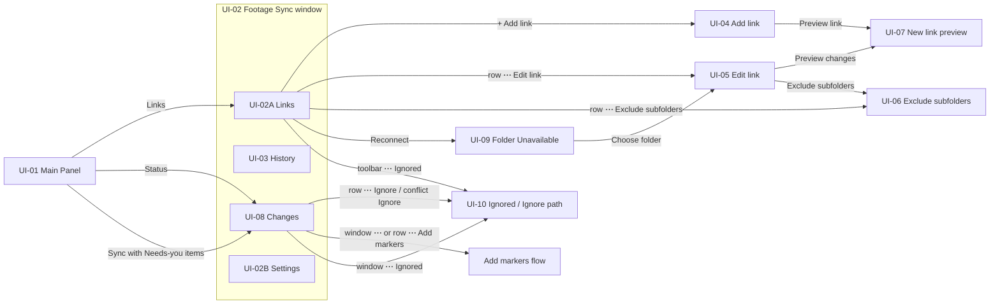

# Footage Sync — UI Contract

> Canonical description of the approved screen structure.  
> Product behavior remains canonical in [`SPEC.md`](../SPEC.md).  
> The interactive implementation in [`prototype/`](../prototype/) is a secondary review reference, not the source of requirements. It predates the 2026-11 redesign; for the redesign use the static HTML twins in [`ui/redesign-2026-11/`](ui/redesign-2026-11/).

---

## 1. How to use this document

For a screen-level task, load:

1. the relevant product section in `SPEC.md`;
2. the single screen section below;
3. only the referenced image (and, when exact copy or structure matters, its HTML twin) from `docs/ui/redesign-2026-11/`.

Do not load the prototype source merely to understand layout. Inspect it only when implementing the UI or resolving an ambiguity.

Precedence when materials disagree:

1. `SPEC.md` — product behavior;
2. this document — screen structure, controls, states and transitions;
3. golden PNG — visual composition and density;
4. static HTML twin of the PNG — exact copy, structure, colors and spacing values;
5. interactive prototype / current runtime — demonstration only.

All user-facing strings are English. Documentation prose may be Russian/English.

### Current visual references — UI redesign 2026-11-06

[LOCKED — user decision 2026-11-06] The user reviewed and approved the redesign on a Claude design canvas (private claude.ai artifact; not needed for implementation). Approved boards are exported into [`ui/redesign-2026-11/`](ui/redesign-2026-11/):

- `*.png` — golden composition and density, rendered at 1× from the boards;
- `*.html` — the static markup/CSS each PNG was rendered from. Open in any browser; no runtime or network needed. Use it to read exact strings, element order and style values. It is a design artifact, not production code.

Example names, paths, counts and timestamps are mock data. Counts follow the counting rule in §2; where an image disagrees with this document, this document wins.

Every screen in §3 has a reference image. Still text-defined: the Add markers TXT picker/clip chooser (§8), the import project / sequence pickers and generic error details — keep their current content and restyle them in the redesign visual language.

### Previous references

The 2026-10-02 golden PNGs (`main-panel.png`, `links.png`, `settings.png`, `status.png`), `links-targets*.png`, `settings-ignore.png`, `ignored-paths.png`, `ignore-path.png`, `workflow-refresh.html` and the FUT-002 runtime captures describe the pre-redesign UI. They remain in `docs/ui/` as history and as a picture of the current implementation until the redesign ships. Do not use them as target layout.

Image dimensions are export dimensions, not window-size requirements.

---

## 2. Global UI rules

### Visual language

- Dark, compact, dense Premiere / Adobe Spectrum style. The redesign boards define palette, type scale and density.
- Use native UXP HTML/Spectrum components where available.
- Quiet by default: state (import target, last sync, paused link, saved status) is quiet text; only items that need an action are visually prominent (amber dot/badge).
- Secondary and rare actions live in ⋯ menus. Destructive actions end with `…` and confirm.
- Main Panel automatically switches between vertical and horizontal icon-only layouts and scales to available size, down to a minimum button size; below it the panel scrolls (UI-01).
- Avoid success popups in AUTO; warnings and errors are always visible.

### Window model

[LOCKED — user decision 2026-11-06, supersedes separate Links / Settings, Status and Review windows]

- Main Panel is always a compact dockable panel. No screen replaces its content.
- All content UI lives in **one Footage Sync window** (UI-02) with tabs `Changes · History · Links · Settings` and a window ⋯ menu. Switching tabs never opens another window.
- Main Panel buttons open that window on their own tab: `Links` → Links; `Status` → Changes; `Sync` with Needs-you items → Changes. If the window is already open it switches to that tab.
- Focused dialogs open over the window: Add link / Edit link (UI-04/05), Exclude subfolders (UI-06), New link preview (UI-07), Folder Unavailable (UI-09), Ignored files and folders / Ignore path (UI-10), the Add markers flow (§8), import project / sequence pickers, error details.
- Opening and closing a dialog or native picker preserves the window state: active tab, decisions, unchecked items, expanded groups and scroll.
- `Sync` is a direct action. It is not a screen.

[SPIKE] ⋯ menus/popovers inside a UXP dialog; dialogs and native pickers over the window without losing state. If a host limitation forces closing the window, its state is restored rather than reset.

### Sync vocabulary

- **Ready change** (safe): may be applied without an additional choice. Shown in `Ready to apply`.
- **Needs-you item** (blocking): requires an in-row choice or action before it can apply — fragmented MP4 in `Ask in Review`, changed marker TXT, conflict, interrupted sequence append, broken import target. Shown in `Needs you`.
- If the batch has no Needs-you items, `Sync` applies it immediately without a window.
- If the batch contains at least one Needs-you item, `Sync` opens Changes for the whole batch. Nothing from that batch is applied before `Apply`.
- `Apply` applies checked Ready changes and decided Needs-you items. Undecided items, and operations that depend on them, are not applied and keep waiting.
- **Counting rule** (badges, tab counts, group counts, `Apply N changes`): count what an editor sees — a file, a bin, a rename/move, the markers of one TXT. Adding a new video to the timeline is a dependent option of that video and is not counted separately.

### Shared states

- Default button hierarchy: one primary action, secondary cancel/close actions, quiet destructive actions.
- Disabled controls must remain legible and explainable from the surrounding state.
- Long paths truncate visually but expose the full value through details or `Copy full path`.
- No disk delete automatically removes a Premiere Project Item/bin.

### Preserved UX references

These images preserve the Watchtower references supplied during product discussion. They are inspiration, not golden Footage Sync screens:

- [`watchtower-main-panel.png`](ui/reference/watchtower-main-panel.png) — compact Main Panel density;
- [`watchtower-select-folders-standard.png`](ui/reference/watchtower-select-folders-standard.png) — filesystem-tree selection;
- [`watchtower-select-folders-advanced.png`](ui/reference/watchtower-select-folders-advanced.png) — dense table-style folder mapping.

---

## 3. Screen index

| ID | Screen/view | Surface | Entry | Visual reference |
|---|---|---|---|---|
| UI-01 | Main Panel | Dockable panel | Premiere Window/Extensions entry | [main-panel.png](ui/redesign-2026-11/main-panel.png) |
| UI-02 | Footage Sync window shell | Window | Main Panel buttons | header/strip in [changes.png](ui/redesign-2026-11/changes.png), menu in [changes-window-menu.png](ui/redesign-2026-11/changes-window-menu.png) |
| UI-02A | Links tab | Window tab | Main Panel `Links`; tab | [links.png](ui/redesign-2026-11/links.png), [links-row-menu.png](ui/redesign-2026-11/links-row-menu.png) |
| UI-02B | Settings tab | Window tab | Tab only | [settings.png](ui/redesign-2026-11/settings.png) |
| UI-03 | History tab | Window tab | Tab | [history.png](ui/redesign-2026-11/history.png), [history-failed.png](ui/redesign-2026-11/history-failed.png) |
| UI-04 | Add link | Dialog | Links `+ Add link` | [add-link.png](ui/redesign-2026-11/add-link.png) |
| UI-05 | Edit link | Dialog | Links row ⋯ › `Edit link…`; UI-09 | [edit-link.png](ui/redesign-2026-11/edit-link.png) |
| UI-06 | Exclude subfolders | Dialog | Links row ⋯ › `Exclude subfolders…`; UI-05 | [exclude-subfolders.png](ui/redesign-2026-11/exclude-subfolders.png) |
| UI-07 | New link preview | Dialog (Changes in new-link mode) | UI-04 `Preview link`; UI-05 `Preview changes` | [new-link-preview.png](ui/redesign-2026-11/new-link-preview.png) |
| UI-08 | Changes tab | Window tab | Main Panel `Status`, `Sync` with Needs-you items, running Sync; tab | [changes.png](ui/redesign-2026-11/changes.png), [changes-expanded.png](ui/redesign-2026-11/changes-expanded.png), [changes-syncing.png](ui/redesign-2026-11/changes-syncing.png), [changes-up-to-date.png](ui/redesign-2026-11/changes-up-to-date.png) |
| UI-09 | Folder Unavailable | Dialog | Links `Reconnect…`; status strip | [folder-unavailable.png](ui/redesign-2026-11/folder-unavailable.png) |
| UI-10 | Ignored files and folders / Ignore path | Dialog | Links toolbar ⋯; window ⋯; Changes row ⋯; conflict `Ignore…` | [ignored.png](ui/redesign-2026-11/ignored.png), [ignore-path.png](ui/redesign-2026-11/ignore-path.png) |

---

## 4. Navigation flow

---

## 5. Screen contracts

## UI-01 — Main Panel

**Purpose:** minimal entry point for the three frequent actions.

**Surface:** one adaptive dockable Premiere panel. Primary workflow is a compact docked vertical column, with approximate size reference `50 × 250 px`; this is not a hard requirement for total host chrome dimensions. Implementation uses a `160` content-pixel width breakpoint and scales square controls to available width/height (button maximum 56 px, icon maximum 32 px). Local Premiere 25.6.2 probe measured `52 × 262` content without overflow; compact docking and horizontal layout were checked. Manifest `minimumSize` (`40 × 48`) is a request, not a host guarantee.

**Layout — [LOCKED, FUT-002 user decision 2026-10-06; sizing rule updated 2026-11-06]:**

1. Three icon actions in the existing order Links / Sync / Status, as a vertical column below the width breakpoint and a horizontal row above it. Switch automatically when width changes.
2. Read actual available panel space and scale icons, button areas and spacing. [LOCKED — user request 2026-11-06] Buttons do not shrink below about `28 px` (exact value fixed during host acceptance). Below that, buttons keep their size and the panel scrolls; all three actions stay usable.
3. No persistent text labels in either orientation. Action names and state descriptions are available through tooltips; keep keyboard activation and visible focus.
4. Remove the plugin-owned header. Prefer also hiding the native Premiere tab/header if a supported mechanism is verified; leaving native chrome is acceptable if hiding is unavailable.
5. Badge variant A — see States. Sync uses an animated working indicator, preferably a circle/spinner. While busy, clicking it opens the window on Changes with live process details and never starts a second run. Stop the animation when work ends or fails.

**Controls:**

| Control | Behavior |
|---|---|
| `Links` | Opens UI-02 on the Links tab. |
| `Sync` | Applies the batch immediately when nothing needs a decision; otherwise opens UI-02 on Changes and applies nothing. While running, its spinner opens live process details. A second run is guarded. |
| `Status` | Opens UI-02 on Changes. Carries the pending count and Needs-you presentation. |

**States — [LOCKED — badge variant A, user decision 2026-11-06]:**

| State | Main Panel presentation |
|---|---|
| Up to date | No badge. Sync remains available as manual scan/sync. |
| Changes pending | Blue numeric badge on Status (counting rule, §2). Sync is direct. |
| Needs-you items | Blue count stays; an additional amber badge with the Needs-you count and an amber Status border; an amber dot on Sync means it will open Changes. Sync applies nothing first. |
| Source unavailable | Attention presentation and pending count when present; Sync disabled; details in the Changes status strip and Links. |
| Syncing | Animated working indicator; click opens Changes with process details; no second Sync; no persistent text label. |

**Tooltip on Status:** repeats the Changes summary, e.g. `34 changes waiting · 3 need you`, notable warnings (`1 TXT skipped`), and that Sync opens the Changes tab first when decisions are open.

**Must not contain:** inline status summary, history, conflict list, Links table, Settings content or Sync mode selector.

**Acceptance environment:** user reports one 2K monitor and one Full HD monitor, mainly docked use. Windows scaling percentages are not supplied; resolution alone does not establish display scale. Record actual scale during host acceptance and check monitor transitions where possible.

**Visual reference:** [main-panel.png](ui/redesign-2026-11/main-panel.png) — variant A in the normal state, the squeezed state at the minimum button size with a scrollbar, and the Status tooltip. Captions in the image are Russian annotations, not UI copy. [SPIKE] Working/attention captures and the keyboard/nonzero-count/DPI/workspace host matrix remain; see [acceptance evidence](../artifacts/panel-host-test/ACCEPTANCE.md).

---

## UI-02 — Footage Sync window

**Purpose:** one place for everything except the direct `Sync` action.

**Surface:** one wide window. Reference widths: Changes boards 1040 px, Links/Settings boards 850 px; these are export sizes, not requirements. Content must stay usable at the narrower width.

**Header:**

- title bar `Footage Sync` and one close control;
- identity mark `FS`;
- tabs `Changes`, `History`, `Links`, `Settings`. `Changes` carries a count; it is amber with a dot while Needs-you items exist (the reference shows `4` = Needs-you items);
- window ⋯ button at the right.

**Window ⋯ menu:**

- `Add markers from TXT…` — hint `Pick a TXT, then the clip it belongs to` (§8);
- `Ignored files and folders (N)…` → UI-10;
- separator;
- `Change import project or timeline…` → project/sequence pickers (SPEC §19).

**Status strip** (quiet, under the tabs on Changes and Links): `Into <project> → <sequence>`, last sync time, link-state notices such as `1 link paused` (opens Links), `Check now`. The target becomes a Needs-you row only when it is broken.

**Reference:** header and strip in [changes.png](ui/redesign-2026-11/changes.png); window menu open in [changes-window-menu.png](ui/redesign-2026-11/changes-window-menu.png).

### UI-02A — Links tab

**Behavior:** SPEC §8.

**Target strip:** `Into <project> · new videos [switch] → <sequence>` and `Change…`. The switch is the saved sequence checkbox from SPEC §19 (off keeps the target and existing edit). A missing/unavailable target is shown in red with `Choose…`; paths and the reason are in tooltip/details. [LOCKED — retained from 2026-10-28] Import project is chosen explicitly from open saved projects (`…_Footage` first as a hint); the sequence chooser lists project → sequence, preferring `…_Selects → Footage`; the choice does not follow the active tab and is restored on open; pending appends finish or are explicitly skipped before the sequence target changes.

**Toolbar:** search by bin or folder; ⋯ button with `Ignored files and folders (N)…`; primary `+ Add link`.

**Table:**

| Column | Content |
|---|---|
| `BIN ↔ FOLDER` | Bin path (bold), system folder below in muted text; relative paths shown relative; `Project root` for root links. |
| `OPTIONS` | Tags: `Subfolders`, `Relative`, `N folders excluded`. Tags are read-only; flags change through `Edit link…`. |
| `STATE` | Dot + `Active · N pending` / `Active · up to date`; `Paused` + `Resume`; `Unavailable` + `Reconnect…` (row tinted). |
| ⋯ | Row menu. |

**Row ⋯ menu:** `Edit link…` → UI-05; `Exclude subfolders…` (hint `Choose folders this link skips`) → UI-06; `Pause` / `Resume`; separator; `Remove link…` (destructive, confirms and states that nothing in Premiere is deleted).

**Footer:** `Saved automatically`, `Close`. There is no Save/Cancel: every change in the tab is saved immediately.

**Empty state:** explain that no folders are linked and present `+ Add link` as the primary action.

**Defaults for a new link:** `Path relative to the project` Off; `Include subfolders` On.

**Reference:** [links.png](ui/redesign-2026-11/links.png) (Active, Paused, Unavailable rows), [links-row-menu.png](ui/redesign-2026-11/links-row-menu.png).

### UI-02B — Settings tab

**Entry:** only through the `Settings` tab. There is no Settings button on Main Panel.

**Rows** (label column on the left, options with one-line descriptions on the right; exact copy in [settings.html](ui/redesign-2026-11/settings.html)):

1. `Apply changes`: `When I press Sync` (`Recommended`, default) / `Automatically`. [LOCKED — user decision 2026-11-06] `Automatically` applies batches in the background; a batch with any Needs-you item waits as a whole (SPEC §6). Copy: `Changes apply in the background. If anything needs a decision, the whole batch waits for you in Changes.`
2. `Fragmented MP4`: `Ask in Review` (default) / `Import original as is` / `Repair before import` — disabled with `Needs the media helper — not in this version` until the helper ships (SPEC §12).
3. `Clip markers`: `Find a marker TXT next to each video`, On by default; helper `TXT name inside the video name, same folder. Applied during Sync.`
4. `Notifications`: `Notify after a successful automatic sync`, Off by default; helper `Warnings and errors are always shown.`

**Footer:** `Saved automatically`, `Close`. Changes save immediately. The ignore list is not in Settings (UI-10).

**Reference:** [settings.png](ui/redesign-2026-11/settings.png).

---

## UI-03 — History tab

**Purpose:** what already happened.

**Purpose — [LOCKED, user decision 2026-11-06, SPEC §15.6]:** a read-only check: did everything sync, and if not, what went wrong. No action buttons. Undecided, not applied and warnings are not shown here — they stay in Changes. The previous Status metrics are not repeated. Counts follow the counting rule.

**Layout:**

1. Left list (about 330 px): `Find a file or folder`; day separators (`TODAY`, `YESTERDAY`, date); one row per run — state dot (green: changes applied; grey: nothing applied; red: failed), title (`Sync`, `Automatic sync`, `New link · <bin>`), time, one summary line (`28 changes`, `No changes`, `Nothing applied · waited in Changes`, `12 changes · 34 files reused`, `Failed · <reason>`). The selected row has a blue left edge.
2. Right: title `<run> · <when>`, meta line (how it started, duration, project → sequence), then `CHANGES · N` — expandable groups `New files`, `New bins`, `Renamed and moved`, `Clip markers` with count and summary. A group expands to folder sub-headers and files (`+ timeline` tag where the video was added); long folders show the first files and `Show N more`.
3. Failed run: a red block above `CHANGES` — `Sync stopped: <reason>`, a plain explanation with what to do, and `Stopped while <stage> · the changes are still waiting in Changes`. `CHANGES` then lists what was applied before the stop, or `Nothing was changed in the project.`
4. Footer: `Close`.

A success notice may appear after an explicit manual action; AUTO stays quiet on success.

**References:** [history.png](ui/redesign-2026-11/history.png) (successful run, `New files` expanded), [history-failed.png](ui/redesign-2026-11/history-failed.png).

---

## UI-04 — Add link

**Behavior:** SPEC §7. One dialog with three numbered steps:

1. `Folder on disk` — path field + `Browse…`; summary below (`3 subfolders: … · 104 media files`).
2. `Where in Premiere` — radio group:
   - `Into an existing bin [bin ▾]` with `Files land in <example path>` and, when useful, `N of M day bins already exist`;
   - `Into a new bin “<folder name>”, inside [bin ▾]` with `Files land in <example path>`.

   [LOCKED — user request 2026-11-06] A bin dropdown is an expandable tree, not a flat list: only top-level bins are visible at first (e.g. `Footage`, `Graphics`, `Sequences`); the arrow expands a bin, the name selects it, any depth. It opens with the path to the current selection expanded and the selected bin highlighted with `✓`. `Project root` is the first item, separated from the bins; footer hint `Arrow opens a bin · name selects it`.
3. `Options` — `Include subfolders` (On), `Path relative to the project` with helper `for project templates` (Off).

**Footer:** hint `Nothing changes in Premiere until you confirm the preview`, `Cancel`, primary `Preview link` → UI-07. `Preview link` is disabled until the folder is valid and a destination is chosen.

[VALIDATED — implementation fix 2026-10-27, carried over] `Browse…` opens the OS picker. If the host requires closing the plugin dialog for the picker, the dialog is rebuilt with the chosen folder; Cancel/failure preserves the destination, typed folder and options; picker failure is shown inline with manual path entry still available. Polling stays suspended through the whole transition. No project mutation occurs before the preview is confirmed.

**Reference:** [add-link.png](ui/redesign-2026-11/add-link.png) (bin tree open on the first option: `Footage` expanded, `Video` selected).

---

## UI-05 — Edit link

**Purpose:** change the bin, folder or options of an existing link.

UI-04 composition titled `Edit link`, populated with the link:

1. `Folder on disk` — field + `Browse…`; a `changed` tag and a line with the previous folder and a summary of the new one when it was replaced.
2. `Premiere bin` — one bin tree dropdown as in UI-04 (`Project root` first) with `Files land in <example path>`. The `Into a new bin` option is not offered: the link already has its bin.
3. `Options` — `Include subfolders`, `Path relative to the project`; a line `Excluded subfolders: <none | N>` with `Exclude subfolders…` (UI-06).

**Footer:** hint, `Cancel`, primary. When the folder or bin changed, the primary is `Preview changes` → UI-07 and nothing changes before its confirmation; when only options changed, the primary follows today's edit flow. Opened from Links row ⋯ › `Edit link…` and from UI-09 `Choose folder…` (then the folder picker opens first).

**Reference:** [edit-link.png](ui/redesign-2026-11/edit-link.png) (folder replaced after the drive moved).

---

## UI-06 — Exclude subfolders

**Behavior:** SPEC §8 «Exclude subfolders».

**Layout:**

- title `<bin> ↔ <folder>`; lead `Unchecked folders are skipped by Sync. Items already in Premiere stay as they are.`;
- `Filter folders` field;
- tree with columns `FOLDER` / `MEDIA` / `SIZE`; disclosure arrows; checkbox = sync. Excluded folders are muted with an `excluded` tag; unusually heavy sizes are highlighted;
- footer summary `N folders excluded · F files · S not synced`, `Cancel`, `Save`.

Saving creates or removes `Folder and subfolders` ignore rules for this link (UI-10 shows them). Counts and sizes may load after the tree appears ([SPIKE] SPEC §8).

**Reference:** [exclude-subfolders.png](ui/redesign-2026-11/exclude-subfolders.png).

---

## UI-07 — New link preview

**Behavior:** SPEC §9. It is UI-08 in new-link mode, in a dialog titled `New link`.

**Differences from UI-08:**

- eyebrow `NEW LINK · PREVIEW`, title `<bin> ↔ <folder>`, reuse summary (`82 files already in the project are reused, nothing is duplicated. Nothing changes until you confirm.`);
- `Ready to apply` grouped by `Folder` by default: folder already in the project (check mark, no checkbox, `N files reused`); folder with relinks (`2 renamed and 1 moved will be relinked`); `new bin` folders with file count, size, first file names (`A003_C001…, A003_C002…, +7`) and tags (`1 TXT skipped`); excluded folders muted with `excluded`; a file waiting for a decision says so in its folder line;
- folder ⋯ menu: `Exclude this folder` (hint `Not synced; nothing in Premiere is touched`), `Show all N files`, `Ignore a file…`;
- the `Add new videos to timeline` row works as in UI-08;
- footer: `N files wait for your decision`, `Cancel`, primary `Link and apply N changes`.

The expected duplicates-created count is zero; existing matching bins/items are reused.

**Reference:** [new-link-preview.png](ui/redesign-2026-11/new-link-preview.png) (folder menu open on `_renders`).

---

## UI-08 — Changes tab

**Behavior:** SPEC §11. Replaces the previous Review Changes and Status windows.

**Layout:**

1. UI-02 header and status strip.
2. **`NEEDS YOU · N`** — amber dot and count; right-side hint `nothing here is applied until you choose`. Rows: amber dot, file name or group title (`2 fragmented MP4`), one muted detail line (amber when it is a warning), then the in-row action:
   - fragmented MP4: segmented `Import originals` / `Skip this time` (`Import original` per file), `Per file` expander on grouped rows;
   - marker TXT changed: `Replace` / `Add to existing` / `Skip TXT`; the detail line warns that Replace also removes manual markers;
   - conflict (e.g. `Used by 2 project items. Remove the duplicate in Premiere, then check again.`): `Ignore…`;
   - interrupted/undone sequence append: `Append again` / `Keep current sequence`;
   - broken import target: action to choose the project/sequence.

   A decided row shows its chosen option highlighted; its dot clears.
3. **`READY TO APPLY · N`** — `Group by` `Type | Folder`, `Select none`. Group rows: checkbox, disclosure, title, count, right-aligned summary and tags. Default groups: `New files`, `New bins`, `Renamed and moved`, `Add new videos to timeline` (`not counted separately · uncheck to import without timeline · V1 + date title on V2`), `Clip markers`.
4. Footnote for self-resolving waits, e.g. `A003_C010_1103XK.mp4 is still copying — it will be picked up on the next check.`
5. Footer: hint `N items wait for you`, `Close`, primary `Apply N changes`.

**Expanded group:** folder sub-headers with their own checkbox and count; file rows with checkbox, name, tags (`+ timeline`; amber `TXT skipped · line 4`; muted `stays pending` when unchecked) and ⋯. Group count reads `19 of 20` when partly unchecked. When Needs-you rows are scrolled away while open, a pinned amber strip shows `N items in Needs you above are still open` with `Show`.

**File row ⋯ menu:** `Ignore this file…` (hint `Hidden from Sync until restored in Links › ⋯ › Ignored`), `Ignore folder <folder>…`, separator, `Import without adding to timeline`, `Add markers from TXT…` (hint `The clip is already chosen — pick only the TXT`), `Copy full path`.

**Carried-over rules [LOCKED — §19 extension 2026-10-28 and 2026-11-04, remapped 2026-11-06]:**

- New footage appends add V1 + native Type Tool date/folder title on V2, with automatic Fill Frame (native-equivalent Motion scaling); Type Tool clip names use the footage folder name. No extra control.
- Unchecking `Add new videos to timeline` (former `Import files only`) applies the selected media/bin/marker changes and skips this batch's appends without resetting the saved target or checkbox; a skipped append does not replay when the target returns. Per file: `Import without adding to timeline`.
- Ordinary media imports stay selectable when only the sequence destination/title has a problem. Folder-name fallback for the title is an informational tag, not a Needs-you item. A changed target timeline invalidates sequence confirmation; files-only confirmation still checks its media sources/project.
- Fragmented MP4: `Skip this time` shows explicit deferral feedback and removes the dependent append for this sync; `Import original` shows the chosen decision and enables the append. Unchecking a file's import also unchecks its append. Existing sources and completed checkpoints do not require the media dependency.
- Marker TXT: safe marker imports sit in `Clip markers`; changed/repeated/interrupted imports are Needs-you rows. An interrupted import allows resuming its original mode or skipping unchanged staged markers. TXT parse/access errors are tags on the file row and never block media import.
- A lost import-project wrapper is reacquired by saved path on regular polling; the broken-target row clears after recovery.

Native evidence for these rules was collected on the pre-redesign UI: [timeline/ignore](TIMELINE_IGNORE_ACCEPTANCE.md), [sequence refinement](SEQUENCE_REFINEMENT_ACCEPTANCE.md), [workflow refresh](UI_REFRESH_ACCEPTANCE.md).

**Ignore:** `Ignore this file…`, `Ignore folder…` and conflict `Ignore…` open UI-10 Ignore path over Changes with the concrete path and scope `File` / `Folder and subfolders`. Only an explicit Ignore saves a rule; Cancel ignores nothing. After saving, analysis refreshes while decisions and checkboxes of remaining items are kept. Logical bin ancestors without a matching disk folder do not offer Ignore. Ignored paths disappear from Changes, History, attention and badges.

**Current process — [LOCKED, SPEC §15.8]:** while a scan/apply runs, the `Changes` tab shows a spinner instead of the dot, the strip says `sync started <time>` and `Check now` is disabled. A blue process card replaces the blocks at the top:

- spinner, `Applying N changes · <stage>` and `<m:ss> elapsed`;
- current file name with its folder path;
- progress bar and `12 of 19 files` only when the stage has known counters; otherwise no bar and no invented percent. During a long host/filesystem wait the card shows the last known stage and how long it has been waiting;
- hint `Closing this window does not stop Sync`;
- stage list: done (green check + duration or `8 done · 3.0 s`), current (spinner, bold, counter), upcoming (muted ring + planned amount);
- warnings so far, one line each (`A003_C004_1103XK.txt · line 4 — TXT skipped, the video imports`).

Below the card, Needs-you items that are not part of this run stay collapsed into one muted row (`2 fragmented MP4 · 1 marker TXT · 1 conflict`, `your choices so far are kept`). Footer: hint `Sync, Check now and Add markers are unavailable until this run ends`, `Close`, disabled primary `Applying…`. When the run ends the card disappears; the result is in History.

**Up to date:** status strip (`last sync … · N links active`, `Check now`) and a centered quiet state — green check, `Up to date`, `Nothing on disk is waiting. New files show up here as soon as they are found.` No blocks, no `Apply`; footer `Close` only.

**References:** [changes.png](ui/redesign-2026-11/changes.png) (two blocks, collapsed groups), [changes-window-menu.png](ui/redesign-2026-11/changes-window-menu.png) (window ⋯ menu), [changes-expanded.png](ui/redesign-2026-11/changes-expanded.png) (expanded group, unchecked file, row ⋯ menu, pinned Needs-you strip), [changes-syncing.png](ui/redesign-2026-11/changes-syncing.png) (current process), [changes-up-to-date.png](ui/redesign-2026-11/changes-up-to-date.png).

---

## UI-09 — Folder Unavailable

**Purpose:** explain a paused/unavailable link and provide non-destructive recovery.

**Entry:** Links `Reconnect…`; the `N link paused` notice in the status strip.

**Content:** red dot and `<bin> ↔ <folder>`; lead `The folder can't be reached — the drive may be disconnected or renamed. This link is paused. Nothing was removed from Premiere, and other links keep syncing.`; details box — Premiere bin (with `N items, unchanged`), System folder, Last available, Pending (`nothing from this link is applied while it is paused`).

**Actions:** quiet `Pause link` on the left, `Close`, primary `Choose folder…` → folder picker, then UI-05 populated with the affected link.

Other available links may continue syncing.

**Reference:** [folder-unavailable.png](ui/redesign-2026-11/folder-unavailable.png).

---

## UI-10 — Ignored files and folders / Ignore path

**Ignored files and folders (N):** rules for the selected import project. Opened from Links toolbar ⋯ and the window ⋯ menu.

- lead: hidden from Sync, Changes and badges until restored; folder rules include subfolders and files added later; items already in Premiere stay; Restore checks the path again on the next scan;
- `Filter` field and `Add path…` (absolute path with scope);
- table `PATH` (name bold, full path muted) / `SCOPE` (`File`, `Folder and subfolders`) / `FROM` (`<bin> · excluded` for UI-06 rules, `Ignored in Changes`) / `Restore`;
- footer `Saved automatically`, `Close`. Changes save immediately and refresh analysis.

**Ignore file or folder:** opened over Changes from a row or conflict. File name and full path; radio group `This file` (`Only this path. A new file with the same name stays ignored too.`) / `Folder <folder> and its subfolders` (`Includes files added to it later.`); note that it is restored in Links › ⋯ › Ignored files and folders, nothing in Premiere is removed and Changes choices are kept; `Cancel` / primary `Ignore`.

**References:** [ignored.png](ui/redesign-2026-11/ignored.png), [ignore-path.png](ui/redesign-2026-11/ignore-path.png).

---

## 6. Acceptance rules

| ID | Given | When | Then |
|---|---|---|---|
| UI-ACC-01 | A batch has no Needs-you items | User presses Main Panel `Sync` | The batch is applied immediately without a window. |
| UI-ACC-02 | A batch has at least one Needs-you item | User presses `Sync` | UI-02 opens on Changes for the entire batch; nothing has been applied. |
| UI-ACC-03 | A linked source is unavailable | Main Panel is visible | Sync is disabled; Status shows attention; the status strip and Links show the paused/unavailable link. |
| UI-ACC-04 | Main Panel is open | User wants Settings | They open the window (`Links` or `Status`) and use the `Settings` tab. |
| UI-ACC-05 | User presses `Links` or `Status` | Window appears | It opens on the matching tab; Main Panel content is unchanged; no second window appears. |
| UI-ACC-06 | A new link is configured | User presses `Preview link` | UI-07 appears before any project mutation. |
| UI-ACC-07 | Fragmented MP4 uses `Ask in Review` | Files are in a pending batch | They appear in `Needs you`, grouped into one row when several. |
| UI-ACC-08 | AUTO completes safely | Sync succeeds | No success popup is shown; warnings/errors remain visible. |
| UI-ACC-09 | Main Panel width changes across its breakpoint | User resizes the docked/floating panel | Layout changes between column and row; all three actions remain accessible. |
| UI-ACC-10 | Main Panel is squeezed below the minimum button size | User reduces available space | Buttons stop shrinking at the minimum and the panel scrolls; actual Windows scale is recorded. |
| UI-ACC-11 | Sync is running | It completes or fails | The working indicator ends and the correct disabled/attention state is restored. |
| UI-ACC-12 | Changes has decisions made and items unchecked | User opens Ignore, Add markers or a target picker and returns | Decisions, unchecked items, expanded groups and scroll are preserved. |
| UI-ACC-13 | Some Needs-you items are undecided | User presses `Apply N changes` | Checked Ready changes and decided items apply; undecided items and their dependent appends stay pending and are still counted. |
| UI-ACC-14 | A batch contains N new videos with timeline appends | Counts are shown | Badge, tab, group and `Apply` counts do not add the appends on top of the videos. |
| UI-ACC-15 | Items need a decision | Main Panel is visible | Status shows the blue count plus the amber Needs-you badge; Sync shows the amber dot. |

---

## 7. Golden image manifest

### Redesign 2026-11-06 (current target)

[LOCKED — user approval on the design canvas, 2026-11-06] Rendered from the canvas boards with headless Chrome at 1×. Each PNG has an HTML twin with the same name.

| Screen | File | Coverage |
|---|---|---|
| UI-01 | [main-panel.png](ui/redesign-2026-11/main-panel.png) | Variant A badge, squeezed state with scroll, Status tooltip |
| UI-02 / UI-08 | [changes.png](ui/redesign-2026-11/changes.png) | Header, tabs, status strip, Needs you + Ready to apply, footer |
| UI-02 | [changes-window-menu.png](ui/redesign-2026-11/changes-window-menu.png) | Window ⋯ menu |
| UI-08 | [changes-expanded.png](ui/redesign-2026-11/changes-expanded.png) | Expanded group, file tags, unchecked file, row ⋯ menu, pinned strip |
| UI-02A | [links.png](ui/redesign-2026-11/links.png) | Target strip, toolbar, table, Active / Paused / Unavailable |
| UI-02A | [links-row-menu.png](ui/redesign-2026-11/links-row-menu.png) | Row ⋯ menu |
| UI-02B | [settings.png](ui/redesign-2026-11/settings.png) | Settings rows, autosave footer |
| UI-04 | [add-link.png](ui/redesign-2026-11/add-link.png) | Three steps, destination options, bin dropdown with Project root |
| UI-06 | [exclude-subfolders.png](ui/redesign-2026-11/exclude-subfolders.png) | Folder tree with media count and size, excluded folders |
| UI-07 | [new-link-preview.png](ui/redesign-2026-11/new-link-preview.png) | New-link mode, folder grouping, folder ⋯ menu |
| UI-03 | [history.png](ui/redesign-2026-11/history.png) | Run list, changes of a run with an expanded group |
| UI-03 | [history-failed.png](ui/redesign-2026-11/history-failed.png) | Failed run: what went wrong |
| UI-08 | [changes-syncing.png](ui/redesign-2026-11/changes-syncing.png) | Current process card, stage list, waiting Needs-you row |
| UI-08 | [changes-up-to-date.png](ui/redesign-2026-11/changes-up-to-date.png) | Up-to-date state |
| UI-05 | [edit-link.png](ui/redesign-2026-11/edit-link.png) | Edit link with replaced folder |
| UI-09 | [folder-unavailable.png](ui/redesign-2026-11/folder-unavailable.png) | Folder Unavailable |
| UI-10 | [ignored.png](ui/redesign-2026-11/ignored.png) | Ignored files and folders list |
| UI-10 | [ignore-path.png](ui/redesign-2026-11/ignore-path.png) | Ignore file or folder scope |

When a product-visible layout changes, update its contract and retire the incompatible image; supply the replacement reference with the change.

### Previous references (retired as target)

| File | Former role |
|---|---|
| [main-panel.png](ui/main-panel.png) | 2026-10-02 Main Panel, already superseded by FUT-002 |
| [main-panel-vertical.jpg](ui/main-panel-vertical.jpg), [horizontal](ui/main-panel-horizontal.jpg), [docked](ui/main-panel-docked.jpg) | FUT-002 runtime captures of the current panel |
| [links.png](ui/links.png), [links-targets-compact.png](ui/links-targets-compact.png), [links-targets.png](ui/links-targets.png) | Links / Settings window, Links view and target rows |
| [settings.png](ui/settings.png), [settings-ignore.png](ui/settings-ignore.png) | Settings view with AUTO / ASK / MANUAL and ignore button |
| [status.png](ui/status.png) | Status window |
| [ignored-paths.png](ui/ignored-paths.png), [ignore-path.png](ui/ignore-path.png) | Ignore list and scope in the Settings flow |
| [workflow-refresh.html](ui/workflow-refresh.html) | Browser fixture of the current runtime UI |

---

## 8. Clip markers UI (FUT-001, updated 2026-11-06)

[LOCKED — user confirmation 2026-10-03, 2026-10-15; entry points changed 2026-11-06]

- Settings: `Clip markers` › `Find a marker TXT next to each video`, On by default (UI-02B).
- Safe marker imports appear in the `Clip markers` group of `Ready to apply`; changed/repeated/interrupted imports are Needs-you rows with `Replace` / `Add to existing` / `Skip TXT`. Replace warns that all source clip markers, including manual ones, will be removed.
- There is no persistent `Add markers…` button and no all-clips list. `Add markers from TXT…` is in the window ⋯ menu and in a clip row ⋯ menu in Changes.
- From the window menu: native TXT picker → searchable source-clip chooser → `Use this clip`. The chooser shows the TXT filename, clip names with full-path details and the selected clip; the helper says the assignment is applied during Sync.
- From a clip row: the clip is already chosen; native TXT picker → confirmation showing TXT and clip.
- Manual suggestions compare TXT basename (case-insensitive) with media basename and visible clip name: exact name before substring; same folder breaks ties within the same match class. Preselect only a unique highest match. Ties/no match require explicit selection. All clips remain searchable and the suggestion can be overridden. This does not change automatic TXT discovery (SPEC §16).
- Neither selecting a suggestion nor choosing another clip applies markers immediately; Cancel at any step saves no assignment and returns to Changes with its state preserved.
- Marker parsing/access failures do not block media import. All times refer to the original source video start; no sequence target/control.

Native marker evidence remains relevant: [Settings](../artifacts/marker-host-test/settings-markers.png), [native source markers](../artifacts/marker-host-test/source-markers.png). The previous Status/Review marker captures are retired.
